# 🧪 Machine Learning Experiments

Welcome to my **Machine Learning Experiments Repository**! This repository contains my Machine Learning laboratory experiments, Python library notes, datasets, model training workflows, and practical implementations of regression and classification algorithms using Python.

**Author:** Prathamesh Balaji Patil
**Branch:** Artificial Intelligence and Machine Learning
**Repository:** [ML_Experiments](https://github.com/Shree0802/ML_Experiments)

---

## 📚 Table of Contents

| No. | Folder / Experiment                                          | Description                                     |
| --: | ------------------------------------------------------------ | ----------------------------------------------- |
|  01 | [Python Libraries](#01-python-libraries)                     | Python libraries and learning resources         |
|  02 | [Dataset and Model Training](#02-dataset-and-model-training) | Datasets and mini assignments                   |
|  03 | [Simple Linear Regression](#03-simple-linear-regression)     | Regression using one independent variable       |
|  04 | [Multiple Linear Regression](#04-multiple-linear-regression) | Regression using multiple independent variables |
|  05 | [Logistic Regression](#05-logistic-regression)               | Binary and multiclass classification            |
|  06 | [Decision Tree Classifier](#06-decision-tree-classifier)     | Decision Tree using Gini Index                  |
|  07 | [KNN Classifier](#07-knn-classifier)                         | Breast cancer and diabetes classification       |
|  08 | [Naive Bayes Classifier](#08-naive-bayes-classifier)         | Text classification mini project                |
|  09 | [Support Vector Machine](#09-support-vector-machine)         | Linear and nonlinear SVM                        |
|  10 | [Random Forest Algorithm](#10-random-forest-algorithm)       | Classification and regression                   |
|  11 | [Assets](#11-assets)                                         | Experiment screenshots and output images        |

---

## 01. Python Libraries

**Folder:** `01_Python-Libraries/`

This folder contains learning resources, notes, and PDF documents for Python libraries used in Data Science, Machine Learning, and Deep Learning.

These resources help with learning, revising important concepts, and understanding the libraries commonly used in AI/ML.

### Screenshot

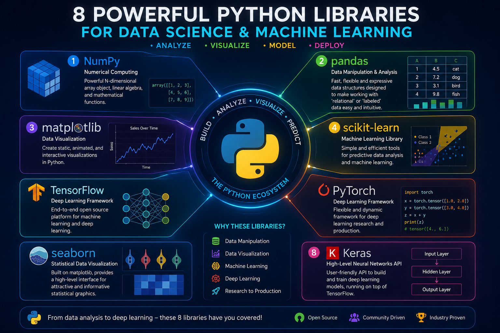

---

## 02. Dataset and Model Training

**Folder:** `02_Dataset/`

This folder contains datasets used in Data Science, Machine Learning, and Deep Learning experiments.

The datasets support:

* Data preprocessing and cleaning
* Exploratory data analysis
* Feature selection and preparation
* Model training and testing
* Model evaluation
* Practical implementation of AI/ML concepts

This folder also includes mini-assignment materials.

### Screenshot

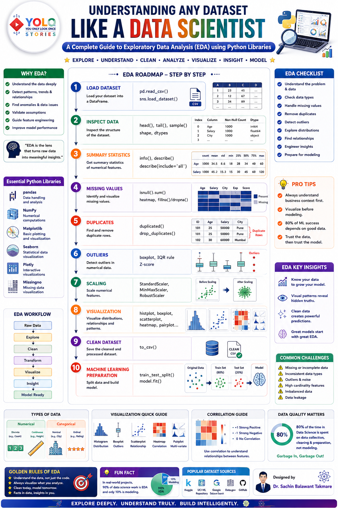

---

## 03. Simple Linear Regression

**Folder:** `03_Simple_Linear_Regression/`

### Objective

Implement Simple Linear Regression to predict values based on a single independent variable.

### Description

This experiment demonstrates Simple Linear Regression using Python. It covers data preprocessing, model training, prediction, and visualization of the regression line.

### Tools Used

* Python
* Pandas
* NumPy
* Matplotlib
* Scikit-learn

### Output

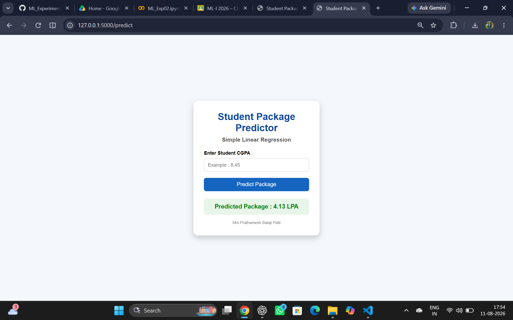

---

## 04. Multiple Linear Regression

**Folder:** `04_Multiple_Linear_Regression/`

### Aim

Implement Multiple Linear Regression using Python and evaluate its performance.

### Description

This experiment demonstrates Multiple Linear Regression using multiple input features to predict a target variable.

The workflow includes data preprocessing, model training, prediction, and evaluation using metrics such as Mean Squared Error (MSE) and R² score.

### Tools Used

* Python
* NumPy
* Pandas
* Matplotlib
* Scikit-learn

### Output

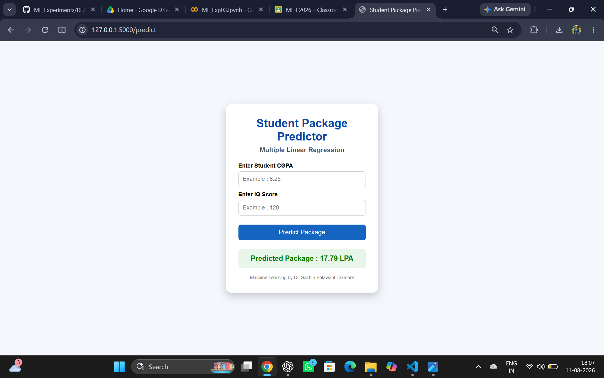

---

## 05. Logistic Regression

**Folder:** `05_Logistic_Regression/`

This folder contains two experiments covering binary and multiclass classification.

### Part 1: Binary Classification

#### Aim

Implement Logistic Regression for binary classification using Python and evaluate its performance.

#### Description

This experiment uses CGPA and IQ score to predict one of two classes using the dataset provided.

The workflow includes:

* Data preprocessing
* Model training using Scikit-learn
* Prediction
* Accuracy evaluation
* Confusion matrix
* Classification report
* ROC curve and AUC analysis

A Flask web application provides an interactive interface where users can enter CGPA and IQ values to obtain a prediction.

#### Student Likely to Be Placed

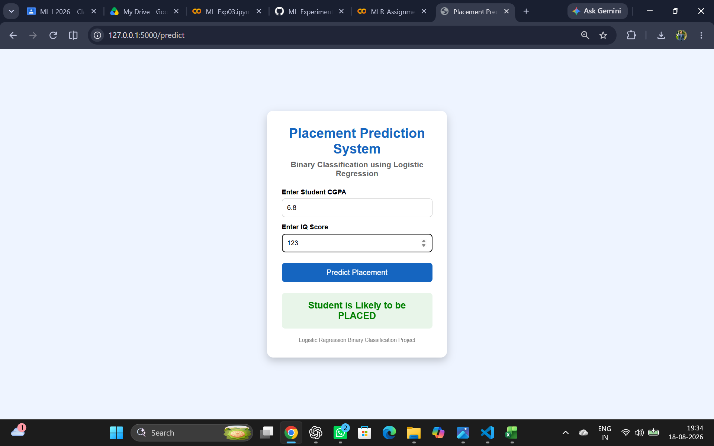

#### Student Likely Not to Be Placed

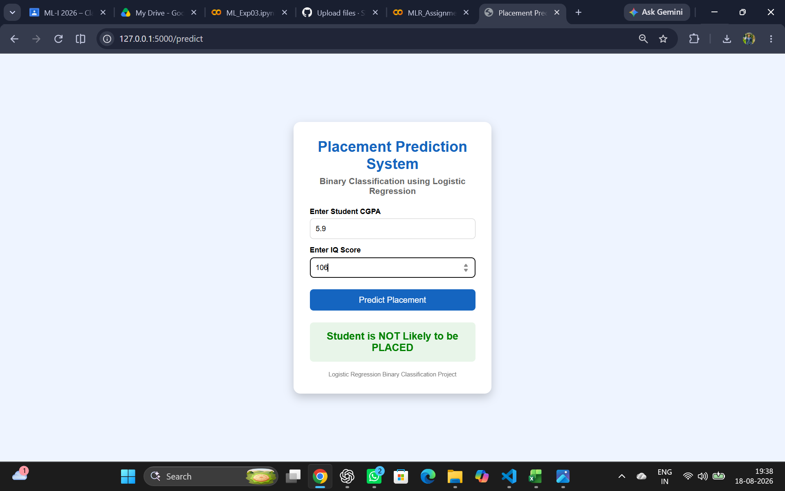

### Part 2: Multiclass Classification

#### Aim

Implement multiclass classification using Python and evaluate the model's performance.

#### Description

This experiment demonstrates Multiclass Logistic Regression for predicting a student's stress category using the features and target labels defined by the experiment's dataset.

The intended categories are:

* Low Stress
* Medium Stress
* High Stress

The experiment includes data preprocessing, model training, prediction, accuracy evaluation, confusion matrix, and classification report.

A Flask web application provides an interactive interface for making predictions.

#### Student Performance Predictor

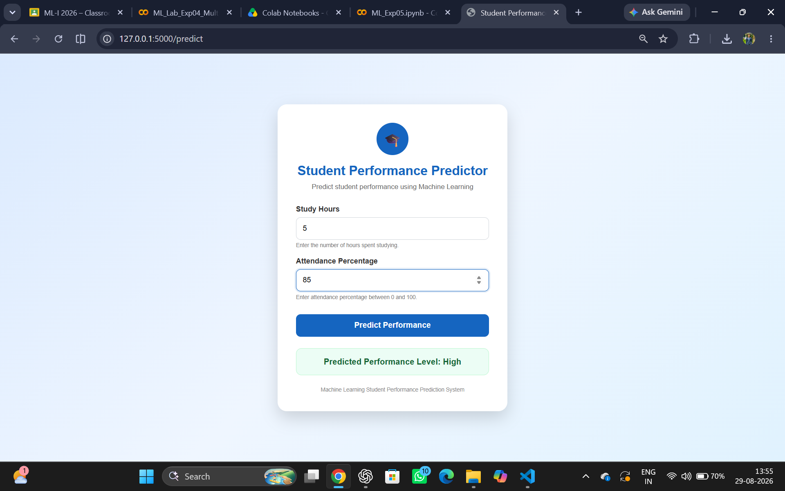

---

## 06. Decision Tree Classifier

**Folder:** `06_Decision_Tree_Classifier/`

### Algorithm

Decision Tree Classification using the Gini Index.

### Aim

Implement a Decision Tree Classifier using Python and evaluate its performance on a classification dataset.

### Description

This experiment uses a Decision Tree Classifier to predict heart disease based on clinical and diagnostic features from the heart disease dataset.

The workflow includes:

* Data preprocessing
* Model training using Scikit-learn
* Prediction
* Accuracy evaluation
* Confusion matrix
* Classification report
* ROC-AUC analysis
* Decision Tree visualization
* Feature importance analysis

A Heart Disease Risk Predictor interface allows users to enter patient details and obtain a model prediction.

**Disclaimer:** This experiment is for educational purposes only and is not a medical diagnostic tool.

### Heart Disease Detected

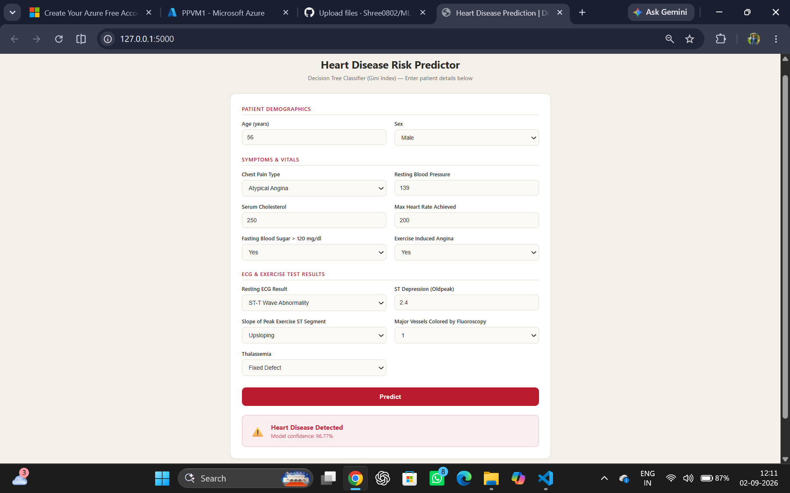

### No Heart Disease Detected

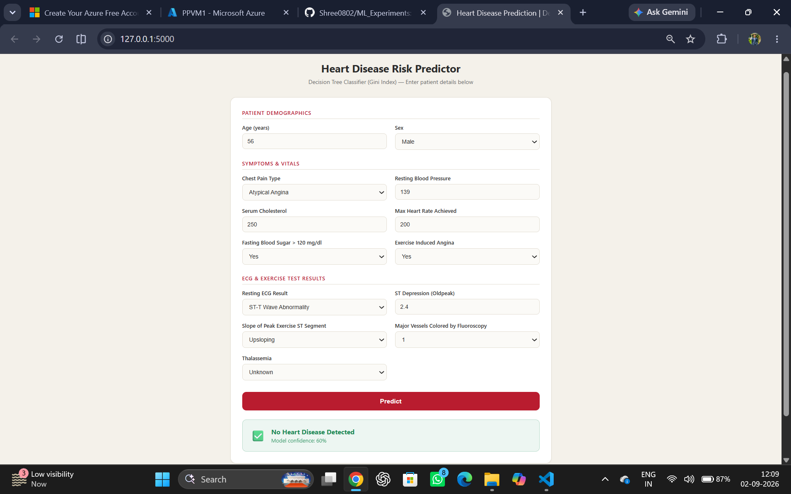

---

## 07. K-Nearest Neighbors (KNN) Classifier

**Folder:** `07_KNN_Classifier/`

### About

This experiment demonstrates the K-Nearest Neighbors classification algorithm using two datasets: Breast Cancer and Diabetes.

### KNN Workflow

1. Load and inspect the dataset.
2. Perform data preprocessing.
3. Explore the data.
4. Split the data into training and testing sets.
5. Scale features where appropriate.
6. Tune the value of K.
7. Train and evaluate the model.
8. Generate predictions.

### Part 1: Breast Cancer Dataset

The KNN classifier predicts whether a breast tumor is benign or malignant using diagnostic measurements.

#### Output

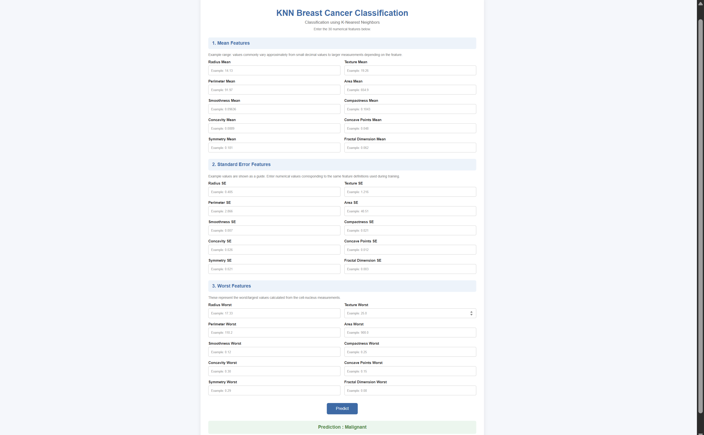

### Part 2: Diabetes Dataset

The KNN classifier predicts the diabetes class using the input features provided by the dataset.

#### Output

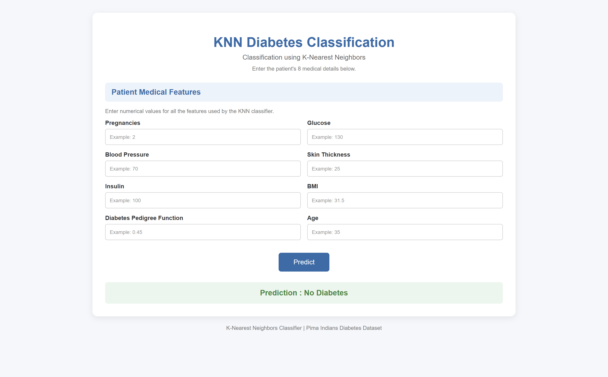

**Disclaimer:** These medical classification experiments are for educational purposes and should not be used for medical diagnosis.

---

## 08. Naive Bayes Classifier

**Folder:** `08_Naive_Bayes_Classifier/`

### Title

Implementation of Naive Bayes Classifier.

### Aim

Implement the Naive Bayes classification algorithm using Python and evaluate its performance on a classification dataset.

### Mini Project: Campus Message Detective

This mini project demonstrates text classification using the Naive Bayes algorithm and its associated text-processing workflow.

### Project Screenshot

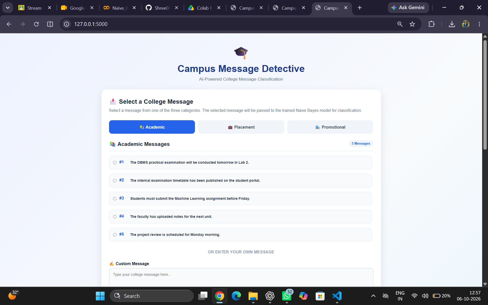

### Output

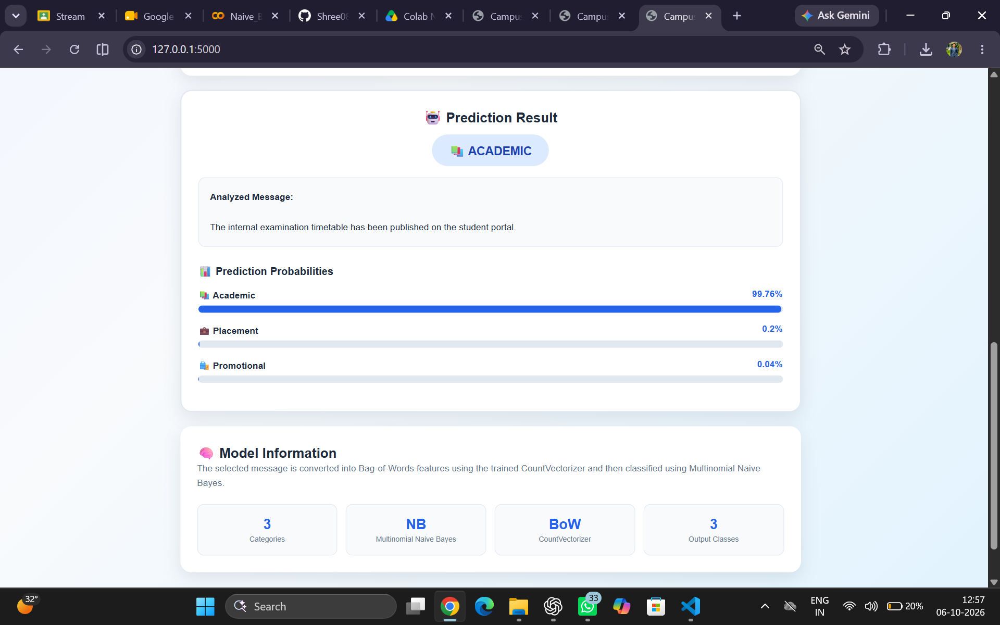

---

## 09. Support Vector Machine (SVM)

**Folder:** `09_Support_Vector_Machine/`

This folder contains implementations of Linear SVM and Nonlinear SVM.

### Part 1: Linear SVM

#### Title

Implementation of Linear Support Vector Machine.

#### Description

This experiment develops a Linear SVM classification model that learns a separating hyperplane from labelled banknote samples.

It uses the Banknote Authentication dataset to classify banknote samples as genuine or counterfeit using numerical features extracted from images.

A Flask web application with an HTML interface provides an interactive prediction experience.

#### Output

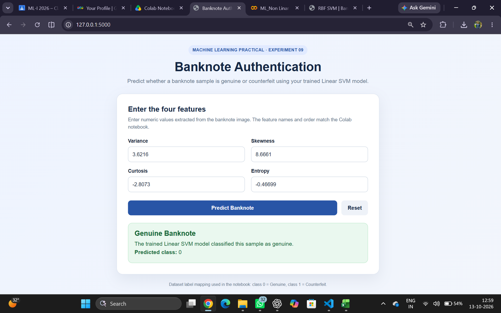

### Part 2: Nonlinear SVM

#### Title

Implementation of Nonlinear Support Vector Machine.

#### Description

This experiment demonstrates nonlinear classification using an SVM with a nonlinear kernel.

The saved RBF SVM model classifies banknote samples using the numerical features required by the experiment.

#### Output

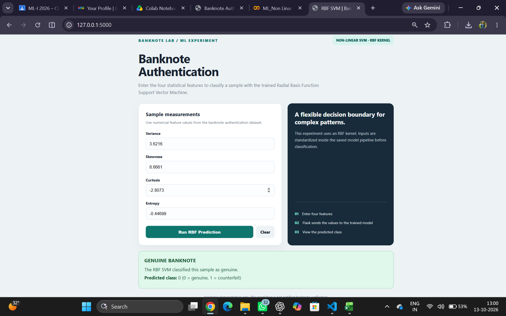

---

## 10. Random Forest Algorithm

**Folder:** `10_Random_Forest_Algorithm/`

### Title

Implementation of the Random Forest Algorithm.

### Problem Statement

Select a suitable real-world problem and dataset to develop an end-to-end Machine Learning project using classification and regression.

Implement and compare Decision Tree and Random Forest algorithms to evaluate their performance.

### Description

This experiment explores the Random Forest algorithm for classification and regression tasks.

The workflow may include:

* Dataset loading and inspection
* Data preprocessing
* Feature and target selection
* Training and testing
* Model prediction
* Performance evaluation
* Comparison of suitable models

### Output

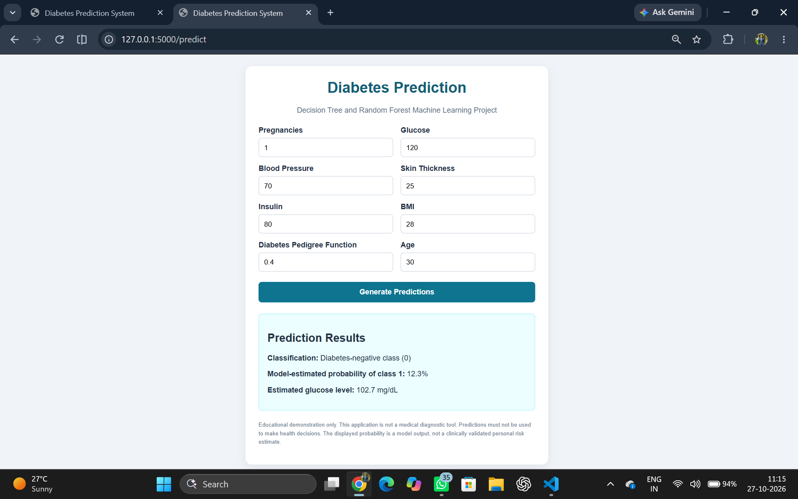

---

## 11. Assets

**Folder:** `assets/`

This folder contains the PNG screenshots and output images used throughout this README.

The images are organized in one location to keep the repository structured and make the documentation easier to maintain.

### Images Included

* `python-libraries.png`
* `dataset.png`
* `Package_Prediction.png`
* `Package_Prediction_MLR.png`
* `Student_Placed.png`
* `Student_Not_Placed.png`
* `Student_Performance_Predictor.png`
* `Heart_Disease_Detected.png`
* `No_Heart_Disease_Detected.png`
* `KNN_Classifier_breast_output.png`
* `KNN_Classifier_dibaties_output.png`
* `NBC_MiniProject.png`
* `nbcMiniproject.png`
* `Linear_SVM.png`
* `Non_Linear_SVM.png`
* `Diabetes_Exp11.png`

All screenshots in this README reference images inside the `assets/` folder.

---

## 🛠️ Technologies Used

* Python
* NumPy
* Pandas
* Matplotlib
* Seaborn
* Scikit-learn
* Flask
* Pickle and Joblib, where used for model persistence
* Jupyter Notebook

---

## 🎯 Learning Objectives

Through these experiments, I aim to develop practical knowledge of:

* Python libraries for data analysis
* Dataset preparation and preprocessing
* Simple and Multiple Linear Regression
* Binary and Multiclass Logistic Regression
* Decision Tree Classification
* K-Nearest Neighbors
* Naive Bayes Classification
* Support Vector Machines
* Random Forest
* Model training and prediction
* Evaluation metrics and visualizations
* Integrating Machine Learning models with Flask applications

---

## 👨‍💻 Author

**Prathamesh Balaji Patil**

Artificial Intelligence and Machine Learning

GitHub: [Shree0802](https://github.com/Shree0802)

---

⭐ If you find this repository useful for learning Machine Learning, feel free to explore the experiments and datasets.
